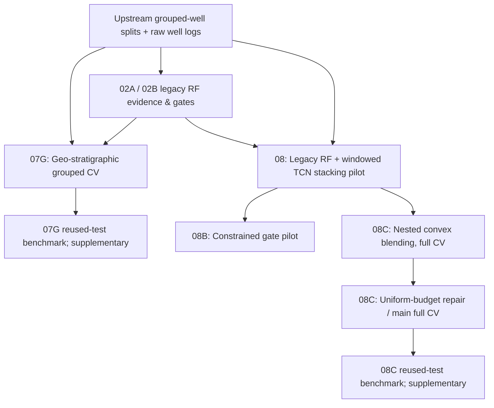

# StrataWeave

**Geo-Stratigraphic Context Meets Temporal Model Fusion**

> A reproducible research code release for combining engineered-feature Random Forest evidence, stratigraphic/spatial priors, and windowed temporal convolutional networks for 12-class lithology classification.

**Dataset case study:** FORCE 2020 well-log/lithofacies data. The dataset name intentionally does not appear in the repository title, but its identity, licensing and provenance must be acknowledged. **No dataset CSV, fitted weights, reusable TCN cache, or generated artifact directory is distributed here.**

**Research status:** Notebook outputs below were saved during prior local experiments. The notebooks were **not rerun after portable-path edits and removal of Persian explanatory Markdown**. Full CV and pilot results must not be conflated. A reused official test split is **not an independent untouched final evaluation**.

## Scientific objective

1. Does a learned lithology classifier benefit from a nearby-well, depth-/formation-conditioned geological prior?
2. Can a depth-window TCN complement an engineered-feature Random Forest trained with grouped well splits?
3. Is a simple, nested-selected convex probability blend more reliable than a complex support-aware stacking/gating model?
4. How sensitive are improvements to the training budget and selection protocol?

### Core methods

- **Legacy RF expert:** exact engineered-feature RF reproduction of the previously specified baseline.
- **Geological prior:** nearby-well/spatial and stratigraphic evidence with support-weighted adaptive fusion.
- **Windowed TCN:** sequence patterns in depth-adjacent well-log windows; grouped splits keep each well out of both training and evaluation simultaneously.
- **Nested convex blending:** combine probability vectors as `p_blend = (1 - alpha) p_legacy + alpha p_TCN`. Select `alpha` with grouped inner validation, not outer-fold label tuning.
- **Reused-test reporting:** explicitly label all results on the earlier-consulted official test set as retrospective, rather than new held-out evidence.

## Notebooks

| Role | Notebook | Stored run | Scientific interpretation |
|---|---|---|---|
| **Geo CV, primary** | [`07G…GATE_FIXED`](notebooks/geo_stratigraphic_fusion/07G_FORCE_legacy_geo_stratigraphic_fusion_SINGLE_NOTEBOOK_GATE_FIXED.ipynb) | Full, five well-group folds; gate passed | Fit/choose adaptive spatial-stratigraphic fusion on grouped training partitions. |
| Geo reused-test supplement | [`07G…EVIDENCE_BASELINE_RAW_SELECTION_FIXED`](notebooks/geo_stratigraphic_fusion/07G_FORCE_legacy_geo_stratigraphic_fusion_EVIDENCE_BASELINE_RAW_SELECTION_FIXED.ipynb) | Test benchmark stored | Compare evidence-only, raw fusion, correction rule, and legacy benchmark; not independent untouched test. |
| Stacking ablation | [`08…WITH_REUSED_FINAL_TEST`](notebooks/ablation_studies/08_FORCE_Legacy_TCN_Geo_Stacking_WITH_REUSED_FINAL_TEST.ipynb) | Pilot, fold 1 | Support-aware stacking vs legacy, TCN, average; not a complete CV claim. |
| Constrained gate ablation | [`08B…CONSTRAINED_GATE`](notebooks/ablation_studies/08B_FORCE_Legacy_TCN_CONSTRAINED_GATE_WITH_REUSED_TEST.ipynb) | Pilot, fold 1 | Limits TCN contribution; empirical result did not establish dominance over a simple average. |
| Convex-blend comparison | [`08C…WITH_REUSED_TEST_FIXED`](notebooks/temporal_fusion/08C_FORCE_Legacy_TCN_NESTED_CONVEX_BLEND_WITH_REUSED_TEST_FIXED.ipynb) | Full, five folds; gate passed | Earlier successful configuration using a distinct compute/training protocol. |
| **Budget-controlled convex blend, primary** | [`08C…FULLCV_BUDGET_REPAIR`](notebooks/temporal_fusion/08C_FORCE_Legacy_TCN_NESTED_CONVEX_BLEND_FULLCV_BUDGET_REPAIR.ipynb) | Full, five folds; gate passed | Standardizes TCN epochs across folds; **main reproducibility run**. |
| Reused official-test supplement | [`08C…FINAL_TEST_LITE`](notebooks/supplementary/08C_FORCE_Legacy_TCN_FINAL_TEST_LITE.ipynb) | Retrospective test run, explicitly flagged | Evaluates frozen blend on previously accessed official test; **not independent**. |

## Recorded results (different protocols; do not pool)

| Comparison / evaluation | Reported metric | Stored result | Boundary |
|---|---|---:|---|
| 07G fused raw output, official test | Accuracy | ~77.44% | Reused official test |
| 07G fused legacy-corrected, official test | Accuracy | ~77.97% | Reused official test |
| Legacy RF prior benchmark, official test | Accuracy | ~80.78% | Earlier reference, not a new held-out test |
| 08 stacking (fold-1 pilot), simple average | Well-balanced macro-F1 | ~0.4216 | Pilot, not all five folds |
| 08 stacking (fold-1 pilot), support-aware stack | Well-balanced macro-F1 | ~0.3894 | Pilot |
| 08B constrained gate (fold-1 pilot) | Accuracy | ~74.84% | Pilot; other objectives differ |
| 08C nested convex blend, prior full CV | Well-balanced macro-F1 | ~0.4270 | Separate training protocol; selected alpha ~0.35 |
| **08C uniform-budget full CV** | **Well-balanced macro-F1** | **~0.4232** | Main controlled-budget run; selected alpha ~0.50 |
| 08C uniform-budget full CV | Well-balanced log loss | ~0.8630 | Same run |

The table reports numbers **recorded in the supplied notebook outputs**, not recomputed after portability changes. Comparing protocols requires attention to inner selection, folds, training epochs and cached models. Stronger headline metrics on a prior configuration do not automatically justify choosing that configuration as the primary reproducible experiment.

## Execution and dependency map



The arrows indicate conceptual requirements and shared caches. They **do not guarantee** that a particular historical saved cache can be reused under modified training settings. Check cache provenance, model/fold hashes and artifact version before replay.

### Repository layout

```text
StrataWeave/
├── README.md
├── RELEASE_NOTES.md
├── .gitignore
├── requirements.txt
├── data/
│   ├── README.md
│   └── raw/.gitkeep
├── artifacts/.gitkeep
├── notebooks/
│   ├── geo_stratigraphic_fusion/  # 07G CV and reused-test reporting
│   ├── ablation_studies/          # 08 stacking and 08B constrained gate
│   ├── temporal_fusion/           # two full-CV 08C protocol variants
│   └── supplementary/            # reused test; *not* untouched evaluation
└── scripts/
    └── pre_publish_check.py
```

## Reproducing with local data

The Jupyter kernels should be launched inside this repository (or `STRATAWEAVE_REPO_ROOT` must point to its root). Place `train.csv` and `test.csv` in `data/raw` *locally*, or specify absolute paths using shell environment variables. Set `STRATAWEAVE_ARTIFACT_ROOT` to the **shared upstream FORCE_Causal_Project folder** if the earlier pipeline generated artifacts there.

```bash
# macOS / Linux: run these in the terminal BEFORE starting Jupyter / VS Code's kernel
export STRATAWEAVE_REPO_ROOT="$HOME/Desktop/StrataWeave"
export STRATAWEAVE_TRAIN_CSV="$HOME/Desktop/train.csv"
export STRATAWEAVE_TEST_CSV="$HOME/Desktop/test.csv"
export STRATAWEAVE_ARTIFACT_ROOT="$HOME/Desktop/FORCE_Causal_Project"
```

`STRATAWEAVE_REPO_ROOT` can usually be omitted when starting from the repository root. The artifact root override is critical when consuming existing stage 01/02/07G/08 caches: it preserves the **expected subdirectory layout** instead of moving gigabytes of prior outputs into the Git repository.

If environment variables were already defined when the notebook kernel started, **restart the kernel** after changing them. Python reads the environment inherited by the running kernel; setting a variable in an unrelated terminal may not affect an existing VS Code kernel.

### Dependency requirements by branch

- **07G Full CV:** `train.csv`, stage `01_clean_splits_support/10_grouped_5fold_well_assignment.csv`, legacy stage `02A_legacy_RF_exact_reproduction/09_reproduction_gate.json`, and artifacts needed for its model evidence.
- **07G corrected reused-test run:** `test.csv`, the corrected branch's frozen `full_cv/13_frozen_fusion_configuration.json`, plus reference gates and caches. **Important:** the shipped CV notebook defaults to `07G_legacy_geo_stratigraphic_fusion/full_cv`, while the corrected final-test notebook expects `07G_legacy_geo_stratigraphic_fusion_corrected/full_cv`. Those are **different artifact branches**; do not assume the first automatically satisfies the second. An appropriate corrected CV artifact run or a carefully verified provenance-preserving migration is necessary.
- **08 Stacking / 08B:** grouped split, `02A` legacy reference gate, 02B OOF and trained caches; historical output is pilot.
- **08C Full CV (two variants):** grouped split, stage `02A` reference, legacy predictions / `08_legacy_TCN_geo_support_aware_stacking/cache`, TensorFlow; compare run configs before reusing caches.
- **08C Reused test:** stage `08C_legacy_TCN_nested_convex_blend/full_cv` completed and frozen, test CSV, reference summary and cache; it explicitly writes a consumed-test sentinel.

**Execution safety:** the final-test notebooks are distributed in their recorded `final_test`/`final_test_reuse` modes. **Do not rerun them casually.** Freeze selection via grouped CV first, verify the provenance and applicable permissions, and only then opt into a reused-test benchmark. Its result cannot be treated as a new independent test.

## Scientific validity and limitations

- Held-out-well outer validation is substantially more relevant than a random row split for spatially and stratigraphically dependent logs. Inner hyperparameters must be selected without outer-fold labels.
- Formation priors and nearby-well evidence are contextual predictive signals; a geo-fusion improvement does not by itself establish a geological causal mechanism.
- Accuracy, macro-F1, well-balanced metrics and log loss answer different questions. Higher macro-F1 may coexist with lower balanced accuracy or worse calibration.
- Uniform 24-epoch TCN budgets constrain comparability of the controlled-run training schedule; this alone is not proof that architecture comparisons are fully controlled.
- The official test set has been **consulted previously** in this research program. Results reported from it are **retrospective benchmarks**, not an untouched final holdout.
- Model data, pretrained weights and intermediate artifacts are **not bundled**. Reproduction requires the appropriate dataset license and existing upstream model artifacts or a complete rerun of earlier repositories.

## Source dataset, citation and license

The examples use the FORCE 2020 well-log lithofacies dataset (a public well-log classification case study). Follow the original dataset host's terms and attribution requirements. The repository will not redistribute dataset rows or weights. Add the scientific citation and attribution prescribed by your data source in any derivative publication. Project code licensing should be chosen only after checking ownership and coauthor contributions.

## Publishing audit

```bash
python3 scripts/pre_publish_check.py
```

The audit checks notebook integrity, parseability of code cells, leftover Persian explanatory Markdown and hard-coded Desktop paths. It does **not** execute experiments or guarantee the reported numbers can be reproduced without external artifacts.
