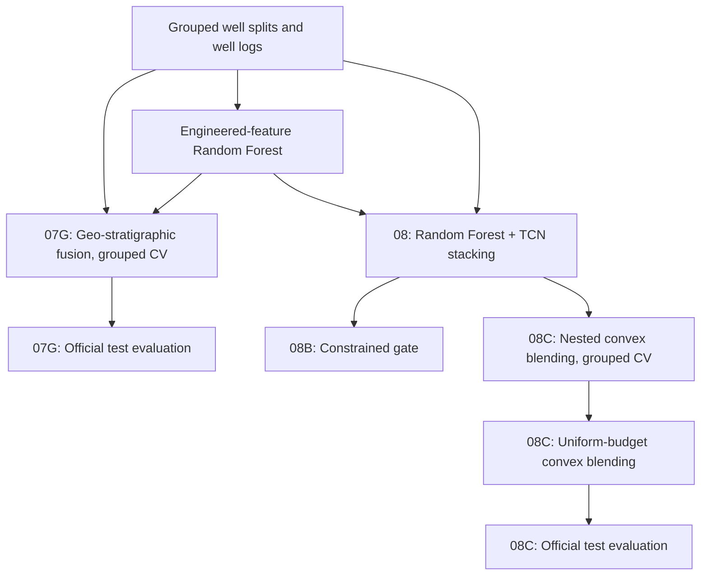

# StrataWeave

**Geo-Stratigraphic Context Meets Temporal Model Fusion**

A research codebase for **12-class lithology classification** from well logs that combines three complementary sources of evidence: an engineered-feature Random Forest, geological priors from nearby wells and stratigraphy, and a windowed Temporal Convolutional Network (TCN) over depth sequences.

The project uses the FORCE 2020 well-log/lithofacies dataset as a case study.

## Contents

- [Research questions](#research-questions)
- [Methods](#methods)
- [Notebooks](#notebooks)
- [Key results](#key-results)
- [Pipeline](#pipeline)
- [Repository layout](#repository-layout)
- [Getting started](#getting-started)
- [Evaluation principles](#evaluation-principles)
- [Future work](#future-work)
- [Data and attribution](#data-and-attribution)

## Research questions

1. Does a lithology classifier benefit from a geological prior built from nearby wells, depth, and formation information?
2. Can a depth-window TCN complement an engineered-feature Random Forest?
3. How does a simple, nested-selected convex blend compare with more complex stacking and gating models?
4. How sensitive are the gains to training budget and model-selection protocol?

## Methods

- **Random Forest expert:** an engineered-feature Random Forest reproduced from a reference baseline.
- **Geological prior:** spatial evidence from nearby wells and stratigraphic context, combined through support-weighted adaptive fusion.
- **Windowed TCN:** learns sequence patterns from depth-adjacent windows of well logs.
- **Nested convex blending:** combines the two models' probabilities as `p_blend = (1 - alpha) * p_RF + alpha * p_TCN`, with `alpha` selected by grouped inner validation.
- **Ablations:** support-aware stacking and constrained gating, compared against simple averaging and convex blending.

All models are evaluated with **well-grouped cross-validation**, so each well appears in either training or evaluation, never both.

## Notebooks

| Study | Notebook | Description |
|---|---|---|
| **Geo-stratigraphic fusion** | [`07G…GATE_FIXED`](notebooks/geo_stratigraphic_fusion/07G_FORCE_legacy_geo_stratigraphic_fusion_SINGLE_NOTEBOOK_GATE_FIXED.ipynb) | Five-fold grouped CV of adaptive spatial-stratigraphic fusion |
| Geo fusion on the official test set | [`07G…EVIDENCE_BASELINE_RAW_SELECTION_FIXED`](notebooks/geo_stratigraphic_fusion/07G_FORCE_legacy_geo_stratigraphic_fusion_EVIDENCE_BASELINE_RAW_SELECTION_FIXED.ipynb) | Compares evidence-only, raw fusion, and corrected fusion outputs |
| Stacking ablation | [`08…WITH_REUSED_FINAL_TEST`](notebooks/ablation_studies/08_FORCE_Legacy_TCN_Geo_Stacking_WITH_REUSED_FINAL_TEST.ipynb) | Support-aware stacking vs. Random Forest, TCN, and simple averaging |
| Constrained gate ablation | [`08B…CONSTRAINED_GATE`](notebooks/ablation_studies/08B_FORCE_Legacy_TCN_CONSTRAINED_GATE_WITH_REUSED_TEST.ipynb) | Gating model with a bounded TCN contribution |
| Convex blend | [`08C…WITH_REUSED_TEST_FIXED`](notebooks/temporal_fusion/08C_FORCE_Legacy_TCN_NESTED_CONVEX_BLEND_WITH_REUSED_TEST_FIXED.ipynb) | Five-fold grouped CV of nested convex blending |
| **Convex blend, uniform training budget** | [`08C…FULLCV_BUDGET_REPAIR`](notebooks/temporal_fusion/08C_FORCE_Legacy_TCN_NESTED_CONVEX_BLEND_FULLCV_BUDGET_REPAIR.ipynb) | Main experiment, with a fixed TCN training budget across all folds |
| Convex blend on the official test set | [`08C…FINAL_TEST_LITE`](notebooks/supplementary/08C_FORCE_Legacy_TCN_FINAL_TEST_LITE.ipynb) | Applies the selected blend to the official test set |

## Key results

| Experiment | Metric | Result |
|---|---|---:|
| **Convex blend, uniform budget (5-fold CV)** | Well-balanced macro-F1 | **0.423** |
| Convex blend, uniform budget (5-fold CV) | Well-balanced log loss | 0.863 |
| Convex blend (5-fold CV) | Well-balanced macro-F1 | 0.427 |
| Geo-stratigraphic fusion (official test) | Accuracy | 77.97% |
| Stacking ablation: simple average vs. support-aware stacking | Well-balanced macro-F1 | 0.422 vs. 0.389 |

**Highlights**

- Nested convex blending combines the Random Forest and TCN with a blending weight selected entirely on inner validation data.
- Simple probability averaging outperformed more complex support-aware stacking, which motivated the convex-blend design.
- Fixing the TCN training budget across folds makes the main experiment directly comparable across folds.

## Pipeline



The grouped well splits and the engineered-feature Random Forest come from the companion repository [FORCE2020-Lithology-Benchmarks-and-Calibration](https://github.com/Mohaddesemoghaddam/FORCE2020-Lithology-Benchmarks-and-Calibration).

## Repository layout

```text
StrataWeave/
├── README.md
├── RELEASE_NOTES.md
├── requirements.txt
├── .gitignore
├── data/
│   ├── README.md
│   └── raw/                       # place train.csv and test.csv here
├── artifacts/                     # intermediate files and model caches
├── notebooks/
│   ├── geo_stratigraphic_fusion/  # 07G experiments
│   ├── ablation_studies/          # 08 stacking and 08B constrained gate
│   ├── temporal_fusion/           # 08C convex blending
│   └── supplementary/             # official test evaluation
└── scripts/
    └── pre_publish_check.py
```

## Getting started

1. Clone the repository and install dependencies:

   ```bash
   git clone https://github.com/Mohaddesemoghaddam/StrataWeave.git
   cd StrataWeave
   python3 -m pip install -r requirements.txt
   ```

2. Place `train.csv` and `test.csv` from the FORCE 2020 dataset in `data/raw/`.
3. Place the outputs of the companion repository in `artifacts/`, or set the environment variables below.
4. Launch Jupyter or VS Code from the repository root and run the notebooks.

### Path configuration

| Variable | Purpose |
|---|---|
| `STRATAWEAVE_REPO_ROOT` | Repository root (auto-detected when launched from the repository) |
| `STRATAWEAVE_TRAIN_CSV` | Training data location |
| `STRATAWEAVE_TEST_CSV` | Test data location |
| `STRATAWEAVE_ARTIFACT_ROOT` | Folder with upstream outputs and model caches |

Example (macOS/Linux), set before starting the notebook kernel:

```bash
export STRATAWEAVE_TRAIN_CSV="$HOME/data/train.csv"
export STRATAWEAVE_TEST_CSV="$HOME/data/test.csv"
export STRATAWEAVE_ARTIFACT_ROOT="$HOME/FORCE_Causal_Project"
```

If you change these variables, restart the notebook kernel so the new values are picked up.

### Inputs by experiment

- **07G grouped CV:** `train.csv`, grouped well-fold assignment, and the reference Random Forest outputs.
- **07G official test:** `test.csv` and the frozen fusion configuration from the corrected 07G CV run (`07G_legacy_geo_stratigraphic_fusion_corrected/full_cv`).
- **08 / 08B:** grouped folds and the reference Random Forest predictions and caches.
- **08C (both variants):** grouped folds, Random Forest predictions, and TensorFlow for the TCN.
- **08C official test:** the completed 08C grouped-CV run and `test.csv`.

The official-test notebooks are designed to run once, after model selection has been finalized with grouped cross-validation.

## Evaluation principles

- **Well-grouped validation:** wells are never shared between training and evaluation folds.
- **Nested selection:** blending weights and hyperparameters are selected on inner folds only.
- **Multiple metrics:** accuracy, macro-F1, well-balanced metrics, and log loss are reported together, since each captures a different aspect of performance.
- **Controlled training budget:** the main experiment uses the same number of TCN training epochs in every fold.

## Future work

- Extend the stacking and gating ablations to all five folds
- Explore richer temporal architectures for the depth-sequence model
- Add per-class analysis for rare lithologies
- Combine the geological prior with the convex blend in a single model

## Data and attribution

This project uses the **FORCE 2020 lithofacies and well-log competition dataset**, which is not redistributed here:

- [Official competition repository](https://github.com/bolgebrygg/Force-2020-Machine-Learning-competition)
- [Dataset record and DOI](https://doi.org/10.5281/zenodo.4351156)

Well logs are released under the Norwegian Licence for Open Government Data (NLOD) 2.0, and lithofacies labels under CC BY 4.0.

> Lithofacies data was provided by the FORCE Machine Learning competition with well logs and seismic 2020.

**Author:** Mohaddese Moghaddam
